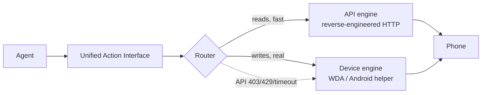

<!-- SPDX-License-Identifier: BUSL-1.1 (pending GC final review) -->

# PhoneHands

[中文](./README.md) | [English](./README.en.md)

-blue)


> **Hero image placeholder (1200px+, one frame of a real phone operated by AI) — awaiting a real shoot. No AI-generated image will ever stand in for a real screenshot.**

**One line: give your AI agent two hands — one speaks API (fast), one taps glass (real). When the API dies, the task doesn't.**

## Honest disclosure

| # | Topic | Stance |
|---|-------|--------|
| 1 | License | **BSL 1.1** (pending GC final text): source fully public; free for non-production; production/commercial needs a license from us (channel announced after GC ruling); auto-converts to Apache 2.0 after 4 years. Not OSI open source — no word games. |
| 2 | ToS gray zone | Only **your own accounts**; read-only by default (writes are a compile-time switch); full audit log + one-key disconnect; never touches your passwords/OTPs (pause → you complete on your phone → resume). |
| 3 | True wireless | **True cross-network wireless on iOS is Apple's wall — we don't promise it.** iOS: Mac + spare iPhone fixed topology, one command → remote endpoint. Android is wireless-first (phone dials out, no USB/LAN), in development. |
| 4 | Telemetry | **Zero telemetry.** Self-hosted, nothing phones home ([ANALYTICS.md](./ANALYTICS.md)). |

**Phase 1 — mock-verified, unpublished.** Public release needs GC + CEO sign-off.

## One-prompt install

Paste to your AI assistant:

```text
You are my PhoneHands deploy assistant. Read this repo's README.md first, then:
1) bash scripts/phonehands-doctor.sh (read-only check);
2) npm install; 3) npm run build; 4) npm test (all green or it doesn't count);
5) Only with Mac + iPhone: bash scripts/remote-topology/test-mock.sh.
Reply READY only when everything passes; list all WARNs.
Stuck? Check docs/troubleshooting.md.
Red line: Apple IDs / passwords / tokens go through my hands or env vars only — never into files or logs.
```

## See it move in 30 seconds

```bash
git clone <repo-url> && cd phonehands   # repo-url announced on D-Day
npm install && npm run build && npm test
cd examples/dual-demo && npm test       # mock "API died, the task didn't" — no phone needed
```

## What it can do

| Action | Example | Which hand | Evidence |
|--------|---------|------------|----------|
| `read` / `likes_received` / `matches` / `chat_messages` | Millisecond structured reads of Hinge data | API engine (read-only, compile-time locked) | `adapters/hinge` mock tests green |
| `observe` | Accessibility-tree first, screenshot fallback | Device engine | `packages/device-backend` mock WDA tests |
| `tap` / `swipe` / `type` / `press_home` / `screenshot` / `launch_app` | Real taps, swipes, typing on a real phone | Device engine | Same; loopback-only asserted |
| Auto-degrade | API 403/429/timeout → device takes over, `degraded:true` marked | Router | `@phonehands/core` fault-injection tests |
| One-command remote topology | One Mac-side command → phone becomes a remote endpoint (self-hosted) | Scripts | `test-mock.sh` 10/10 PASS |
| Environment doctor | Read-only diagnosis: node/npm/WDA signing/tunnel, each FAIL ships a fix | Scripts | Read-only, changes nothing |

**Not yet**: API writes (Phase 2); pixel-perfect locating on self-drawn UIs; 7-day signing without renewal; GitHub public / npm publish.

## How the dual engine works



**Degradation in one line**: API 403 → the device hand takes over. Every result carries `degraded`; uncertain actions are never replayed.

## Install

### Prerequisites

| Need | Requirement |
|------|-------------|
| Local dev (no phone) | node 22+, npm, git; `bash scripts/phonehands-doctor.sh` checks it all |
| iOS real device | Mac + Xcode + USB iPhone (WDA signed with your Apple ID, unlock by hand) |
| Android real device | Side-load the helper APK (source in `packages/android-helper`, in development) + relay URL |

1. `git clone <repo-url> && cd phonehands` (repo-url announced on D-Day)
2. `npm install`
3. `npm run build && npm test`

### One-command remote topology (the third leg)

Mac: `bash scripts/remote-topology/setup.sh`. Android: helper APK (in development) + `PHONEHANDS_RELAY_URL`.
Non-technical manual: `scripts/remote-topology/DEPLOY.md`. No Mac? `bash scripts/remote-topology/test-mock.sh`.

## Quick start (copy-paste)

**1. Read** (mock, no phone needed)

```ts
// adapters/hinge/tests/hinge-adapter.test.ts — read the tests first
const hinge = new HingeApiAdapter({ baseUrl: mock.url, locale: { language: "en-US", region: "US" } });
const likes = await hinge.likes_received({ limit: 20 }); // { ok, backend, latency_ms, degraded, evidence }
```

**2. Look + tap** (needs the device-engine link)

```ts
const tree = await wda.observe();                 // tree-first; screenshot fallback when unusable
const pt = screenshotToTapPoint(shot, box, geom); // caller supplies normalized box → WDA coords
await wda.tap(pt.x, pt.y);                        // single attempt; never replayed on timeout
```

**3. Degradation demo** (mock, no phone needed)

```bash
cd examples/dual-demo && npm test
# scenario: read 20 matches → inject API 403 → device takes over, degraded:true in the envelope
```

## Technical highlights

1. **Dual engines + auto-degrade**: reads via API (milliseconds), writes via device (human-like); the task survives the API dying, degradation honestly marked.
2. **Read-only is a compile-time switch**: write methods don't exist in read-only builds. Opening writes means recompiling yourself. Deliberate.
3. **Never replay the uncertain**: timed-out/disconnected writes return `evidence.uncertain=true`; the Router decides next, never blind-retries.
4. **Loopback-only by default**: the device link rejects non-loopback addresses, asserted in tests.
5. **Secrets never land**: session file 0600/atomic-write/zod-validated + strict permission gate; OTPs only via no-echo TTY; redaction across the log path.
6. **Self-hosted end to end**: topology defaults to self-hosted headscale (BSD-3); healthcheck's relay-path validation FAILs third-party cloud relay domains outright.
7. **Docs are the contract**: every "supports X" here has test evidence; claims still waiting on a package are under "Evidence backlog".

## Action matrix

| Action | API engine | iOS device engine | Android device engine |
|--------|------------|-------------------|-----------------------|
| `read` / `likes_received` / `matches` / `chat_messages` | supported (read-only) | — | — |
| `observe` | — | supported (tree-first + screenshot fallback) | supported (protocol frozen) |
| `tap` / `swipe` / `type` / `press_home` / `screenshot` / `launch_app` | — | supported | supported (protocol frozen) |

Actions defined in `@phonehands/core`; capability tables in each package's `capabilities.ts`.

## Troubleshooting (top 10)

| Symptom | Cause | Fix |
|---------|-------|-----|
| `npm test` fails | build incomplete | `npm install && npm run build && npm test` |
| WDA signing expired | free Apple ID lasts 7 days | `bash scripts/remote-topology/resign.sh` (unlock the phone by hand) |
| Hinge 412 error | email verification challenge | `submitEmailChallenge()`, then complete it in your mailbox |
| session load refused | file permissions loosened | delete `~/.phonehands/hinge.session.json`, re-run `loginInteractive()` |
| OTP prompt refuses to run | non-TTY echo risk | run in a real terminal, not a pipe/CI |
| frequent 429s | rate limited | built-in backoff honors Retry-After; serial queue throttled (800ms); don't parallelize |
| Android can't reach the agent | relay URL missing/unreachable | check `PHONEHANDS_RELAY_URL` (format in `packages/android-helper/PROTOCOL.md`) |
| real device not recognized over USB | computer not trusted / usbmuxd down | tap "Trust" on the phone; Mac: `brew services start usbmuxd` |
| write methods unavailable | Phase 1 API engine is compile-time read-only | by design; writes go through the device engine (Phase 2 expands) |
| can't tell which hand acted | didn't read the envelope | every result carries `backend` + `degraded` — trust those fields |

More: [docs/troubleshooting.md](./docs/troubleshooting.md) (top 30).

## Changelog

[CHANGELOG.md](./CHANGELOG.md) — what changed + verification + upgrade guide. Latest: v0.1.0 (unreleased).

## Dependencies & credits

[THIRD_PARTY_NOTICES.md](./THIRD_PARTY_NOTICES.md). Core credits:

- **appium/WebDriverAgent** (BSD-3), **juanfont/headscale** (BSD-3)
- **emazaheri/ios-agent** (MIT per public page, pending GC ruling) — device-engine architecture ideas
- **agentskills** standard (Apache-2.0) — skill frontmatter spec
- Clean-room learnings: SideTap signing-ops, iPhone Use teardown, vanxh/instagram-personal-mcp (T2 patterns)

## License

**BSL 1.1 (pending GC final text).** Source fully public; free for non-production; production/commercial needs a license from us (channel announced after GC ruling); auto-converts to Apache 2.0 after 4 years.
Header on every source file: `SPDX-License-Identifier: BUSL-1.1 (pending GC final review)`. Never MIT.
Third-party notices: [THIRD_PARTY_NOTICES.md](./THIRD_PARTY_NOTICES.md).

## Evidence backlog (docs-as-contract gate)

| Claim | Status | Evidence ETA |
|-------|--------|--------------|
| Android helper APK on a real phone | In development (Kotlin source + protocol frozen) | After topology + spare device ready (gate 4b) |
| iOS topology on real hardware | Scripts written + mock 10/10 PASS | Same as above (gate 4b) |
| Real-device degrade demo (dual-screen recording) | Demo script is mock-only | Same (gate 4b) |
| npm public publish | All packages `private: true`, unpublished | After GC + CEO dual sign-off |
| iOS Simulator real-WDA protocol chain (gate 4a) | ✅ In CI (`.github/workflows/ios-simulator.yml`, manual + weekly): real WDA built + launched on iPhone Simulator; `simulator-live.test.ts` runs session bootstrap / real auto-heal / tree parse / screenshot / tap / swipe with zero mocks | Landed |
| Android Emulator protocol chain + adb smoke (gate 4a) | ✅ In CI (`.github/workflows/android-emulator.yml`, manual + weekly): e2e assertions + real adb tap/screencap on a real Android OS | Landed |
| CI badge lit | Workflows ready | Lights up after public release |

### Gate 4: two-tier verification (4a / 4b) — read before quoting our test results

| Tier | Runs | Proves | Does NOT prove |
|---|---|---|---|
| **4a (landed, $0)** | GitHub Actions: real WDA on iPhone Simulator (macOS runner); real adb commands on Android Emulator | The **full protocol** our client speaks (session/settings/tree/screenshot/tap/swipe/auto-heal) works against **real WDA and a real Android OS** | Physical-device touch sampling, system dialogs, call/network interruptions, 7-day free-signing expiry, helper APK background persistence |
| **4b (pending hardware)** | Mac Mini + spare iPhone + spare Android, physical | Everything 4a cannot prove | — |

**Wording red line**: always say "Simulator/Emulator protocol-chain verified"; **never** say "real-device testing passed". Calling 4a real-device testing is misrepresentation — one strike and the claim is pulled.

## Star History

[](https://star-history.com/#HUIIIM/phonehands&date)
