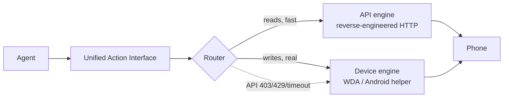

<!-- SPDX-License-Identifier: BUSL-1.1 -->

# PhoneHands

A phone-control framework for AI agent developers: one Action interface over two engines, reads through the
API (fast) and taps on a real device (real); when the API fails, the Router hands the task to the device
engine and marks the result as degraded.

| | |
|---|---|
| Status | Phase 1 · v0.1.0, unreleased — mock-verified; iOS Simulator / Android Emulator protocol chains verified in GitHub Actions (manual + weekly); physical-device retest (gate 4b) pending hardware |
| Deployment | Self-hosted: Node 22+ monorepo (npm workspaces); iOS devices need Mac + Xcode + USB iPhone; Android helper APK in development |
| Live demo | Not applicable — a local library and scripts, no hosted service; local mock demo in [`examples/dual-demo`](./examples/dual-demo) |
| Interfaces | TypeScript library (`@phonehands/core` unified Action interface) · command-line scripts (environment doctor, remote topology) |
| Licence | BUSL-1.1 ([LICENSE](LICENSE)), licensor VERTCITY LLC |
| Languages | [简体中文](./README.md) · English |
| Contact | Security: no SECURITY.md yet · Product: [vertciti.com](https://vertciti.com) |

The demo recording (8-second GIF, recorded from the real code path against local services) and product
images are in [docs/assets](./docs/assets); they are linked rather than embedded.

## Overview

An agent can drive a phone two ways: call the app's HTTP endpoints, which is fast but breaks when the app
updates, or tap the real screen, which is slower but closer to a person using the phone. PhoneHands puts both
behind one unified Action interface: reads go to the API engine by default; on API 403/429/timeout the Router
moves the same task to the device engine. Every result carries `backend` and `degraded` fields, so a
degradation is never silent.

The recorded scenario: after the Hinge endpoint returned 403, the device engine took over and read all 20
matches.

On day one you can build, test and run the mock degradation demo without a phone; with a Mac and an iPhone,
one command turns the phone into a self-hosted remote endpoint.

## Capabilities

| Action | What it does | Engine | Evidence |
|--------|--------------|--------|----------|
| `read` / `likes_received` / `matches` / `chat_messages` | Structured JSON reads of Hinge likes, matches and chat | API engine (read-only, compile-time locked) | `adapters/hinge` mock tests |
| `observe` | Accessibility tree first, screenshot fallback | Device engine | `packages/device-backend` mock WDA tests |
| `tap` / `swipe` / `type` / `press_home` / `screenshot` / `launch_app` | Taps, swipes and typing on a real phone | Device engine | Same; loopback-only asserted |
| Auto-degrade | API 403/429/timeout → device takes over, `degraded:true` marked | Router | `@phonehands/core` fault-injection tests |
| One-command remote topology | One Mac-side command → phone becomes a remote endpoint (self-hosted, no third-party cloud) | Scripts | `scripts/remote-topology/test-mock.sh` |
| Environment doctor | `phonehands-doctor.sh` read-only check of node/npm/WDA signing/tunnel; each FAIL comes with a fix | Scripts | Read-only, changes nothing |

By engine:

| Action | API engine | iOS device engine | Android device engine |
|--------|------------|-------------------|-----------------------|
| `read` / `likes_received` / `matches` / `chat_messages` | supported (read-only) | — | — |
| `observe` | — | supported (tree-first + screenshot fallback) | protocol frozen; device verification pending gate 4b |
| `tap` / `swipe` / `type` / `press_home` / `screenshot` / `launch_app` | — | supported | protocol frozen; device verification pending gate 4b |

Actions are defined in `@phonehands/core`; capability tables live in each package's `capabilities.ts`.

## Quick start

```bash
git clone <repo-url> && cd phonehands   # repo-url published at public release
npm install && npm run build && npm test
cd examples/dual-demo && npm test       # mock degradation demo, no phone needed
```

### Prerequisites

| Need | Requirement |
|------|-------------|
| Local dev (no phone) | node 22+, npm, git; `bash scripts/phonehands-doctor.sh` checks it all |
| iOS device | Mac + Xcode + USB iPhone (WDA signed with your own Apple ID, phone unlocked by hand) |
| Android device | Side-load the helper APK (source in `packages/android-helper`, in development) + a relay URL the agent can reach |

Device setup: [docs/getting-started.md](./docs/getting-started.md).

### One-command remote topology

Mac: `bash scripts/remote-topology/setup.sh` (check → dependencies → WDA source → signing → USB forwarding →
tunnel → endpoint). Android: helper APK (in development) + `PHONEHANDS_RELAY_URL`.
Manual for non-technical operators: `scripts/remote-topology/DEPLOY.md`. No Mac? Run the mock:
`bash scripts/remote-topology/test-mock.sh`.

### Code examples

**Read** (mock, no phone needed)

```ts
// adapters/hinge/tests/hinge-adapter.test.ts
const hinge = new HingeApiAdapter({ baseUrl: mock.url, locale: { language: "en-US", region: "US" } });
const likes = await hinge.likes_received({ limit: 20 }); // { ok, backend, latency_ms, degraded, evidence }
```

**Look + tap** (needs the device-engine link)

```ts
const tree = await wda.observe();                 // tree-first; screenshot fallback when unusable
const pt = screenshotToTapPoint(shot, box, geom); // caller supplies normalized box → WDA coords
await wda.tap(pt.x, pt.y);                        // single attempt; never replayed on timeout
```

**Degradation demo** (mock, no phone needed)

```bash
cd examples/dual-demo && npm test
# scenario: read 20 matches → inject API 403 → device takes over, degraded:true in the envelope
```

### Install through an AI assistant

Paste this to your AI assistant:

```text
You are my PhoneHands deploy assistant. Read this repo's README.md first, then:
1) bash scripts/phonehands-doctor.sh (read-only check);
2) npm install; 3) npm run build; 4) npm test (all green or it doesn't count);
5) Only with Mac + iPhone: bash scripts/remote-topology/test-mock.sh.
Reply READY only when everything passes; list all WARNs.
Stuck? Check docs/troubleshooting.md.
Red line: Apple IDs / passwords / tokens go through my hands or env vars only — never into files or logs.
```

## Architecture



- **Dual engines + auto-degrade**: reads via the API, writes via the device; each result's `degraded` field
  says when a fallback happened. `degradeAfterFaults` is configurable: the demo switches after one 4xx;
  three is recommended for production (debounce).
- **Read-only is a compile-time switch**: write methods do not exist in read-only builds; enabling writes
  means recompiling.
- **No replay of uncertain actions**: timed-out or disconnected writes return `evidence.uncertain=true`; the
  Router decides the next step and never retries blindly (MV427).
- **Loopback-only by default**: the device link rejects non-loopback addresses, asserted in tests.

Details: [docs/architecture.md](./docs/architecture.md).

## Security and compliance

- **Your own accounts only.** The API engine uses a reverse-engineered HTTP client, which sits in a grey area
  of platform terms of service; it is read-only by default and write methods are absent from the default build.
- **Audit and disconnect.** Full audit log and one-key disconnect.
- **Credentials are never handled or stored by the framework.** It never touches passwords or OTPs (pause →
  you complete on your phone → resume); session files are 0600, atomically written and zod-validated behind
  a strict permission gate; OTPs only via a no-echo TTY; logs are redacted end to end.
- **Zero telemetry.** Self-hosted; nothing is sent back ([ANALYTICS.md](./ANALYTICS.md)). Remote topology
  defaults to self-hosted headscale; the healthcheck's relay-path validation fails third-party cloud relay domains.
- **No jailbreak or root.** iOS uses WDA (signed with your own Apple ID); Android uses the helper APK
  (accessibility / screen-record permissions, listed in `packages/android-helper/PROTOCOL.md`).

There is no SECURITY.md vulnerability-reporting process in the repository yet.

## Status and limitations

v0.1.0, unreleased. The repository is public (released under GC-20261022-024), and every npm package
is `private: true`. No CI runs on pull requests yet; the workflows in place are the iOS Simulator and Android
Emulator protocol chains (manual + weekly).

**Not supported today**: API writes (Phase 2); precise targeting on self-drawn UIs such as WeChat; free Apple ID
signing expires every 7 days and needs re-signing; true cross-network wireless on iOS (an Apple platform
limit, not promised; the current path is a fixed Mac + spare iPhone topology); an MCP server (none exists).

### Evidence backlog

| Claim | Status | Evidence due |
|-------|--------|--------------|
| Android helper APK on a real phone | In development (Kotlin source + protocol frozen) | After topology + spare device are ready (gate 4b) |
| iOS remote topology on real hardware | Scripts written, mock passes | Same (gate 4b) |
| Real-device degradation demo (dual-screen recording) | Demo script is mock-only | Same (gate 4b) |
| npm public publish | Unpublished | After GC + CEO sign-off |
| iOS Simulator real-WDA protocol chain (gate 4a) | In CI (`.github/workflows/ios-simulator.yml`, manual + weekly): real WDA built and launched on iPhone Simulator; `simulator-live.test.ts` runs session bootstrap / auto-heal / tree parse / screenshot / tap / swipe with no mocks | Landed |
| Android Emulator protocol chain + adb smoke (gate 4a) | In CI (`.github/workflows/android-emulator.yml`, manual + weekly): e2e assertions + real adb tap/screencap on a real Android OS | Landed |

### Gate 4: two-tier verification (4a / 4b)

| Tier | Runs | Proves | Does not prove |
|---|---|---|---|
| **4a (landed)** | GitHub Actions: real WDA on iPhone Simulator (macOS runner); real adb commands on Android Emulator | The full protocol the client speaks (session/settings/tree/screenshot/tap/swipe/auto-heal) works against real WDA and a real Android OS | Physical-device touch sampling, system dialogs, call/network interruptions, 7-day free-signing expiry, helper APK background persistence |
| **4b (pending hardware)** | Mac Mini + spare iPhone + spare Android, physical | Everything 4a cannot prove | — |

**Wording**: say "Simulator/Emulator protocol-chain verified", never "real-device testing passed".

## Troubleshooting (top 10)

| Symptom | Cause | Fix |
|---------|-------|-----|
| `npm test` fails | build incomplete | `npm install && npm run build && npm test` |
| WDA signing expired | free Apple ID lasts 7 days | `bash scripts/remote-topology/resign.sh` (unlock the phone by hand) |
| Hinge 412 error | email verification challenge | `submitEmailChallenge()`, then complete it in your mailbox |
| session load refused | file permissions loosened | delete `~/.phonehands/hinge.session.json`, re-run `loginInteractive()` |
| OTP prompt refuses to run | non-TTY echo risk | run in a real terminal, not a pipe/CI |
| frequent 429s | rate limited | built-in backoff honours Retry-After; serial queue throttled (800 ms); don't parallelise |
| Android can't reach the agent | relay URL missing/unreachable | check `PHONEHANDS_RELAY_URL` (format in `packages/android-helper/PROTOCOL.md`) |
| device not recognised over USB | computer not trusted / usbmuxd down | tap "Trust" on the phone; Mac: `brew services start usbmuxd` |
| write methods unavailable | Phase 1 API engine is compile-time read-only | by design; writes go through the device engine (Phase 2 expands) |
| can't tell which engine acted | envelope not read | every result carries `backend` + `degraded` — use those fields |

More: [docs/troubleshooting.md](./docs/troubleshooting.md).

## FAQ

**How is this different from iPhone Use?**
iPhone Use is device-layer only (USB-tethered WDA). PhoneHands is dual-engine (API + device) with Router
auto-degrade, plus one-command remote topology. We studied iPhone Use clean-room; credits below.

**Does my account data pass through your servers?**
No. Self-hosted, zero telemetry, nothing is sent back.

**Is it production-ready?**
No. Phase 1 is mock-verified and unreleased; wait for gate 4b (physical-device retest). You can run
`examples/dual-demo` locally without a phone.

**How do I plug it into my agent?**
Call `@phonehands/core`'s unified Action interface (`read` / `observe` / `tap` …) directly, or hand the
"Install through an AI assistant" section to your assistant. There is no MCP server today.

**It won't run — what now?**
Run `bash scripts/phonehands-doctor.sh` (read-only; it tells you what is missing and how to fix it), then
check [docs/troubleshooting.md](./docs/troubleshooting.md).

## Documentation · Support · Licence

[Getting started](./docs/getting-started.md) · [Architecture](./docs/architecture.md) ·
[Troubleshooting](./docs/troubleshooting.md) · [Quality gates](./docs/quality-gates.md) ·
[Release SOP](./docs/release-sop.md) · [Changelog](./CHANGELOG.md) (current: v0.1.0, unreleased) ·
[Telemetry statement](./ANALYTICS.md)

**Dependencies and credits** (every upstream in [THIRD_PARTY_NOTICES.md](./THIRD_PARTY_NOTICES.md)):

- **appium/WebDriverAgent** (BSD-3) — UI automation service on iPhone
- **juanfont/headscale** (BSD-3) — self-hosted WireGuard coordination
- **emazaheri/ios-agent** (MIT per its public page, pending GC ruling) — device-engine architecture and WDA client ideas
- **agentskills** standard (Apache-2.0) — skill frontmatter spec
- Clean-room learning: SideTap (ucsandman) signing operations, iPhone Use, vanxh/instagram-personal-mcp (T2 patterns)

**Cite**

```bibtex
@misc{phonehands,
  title = {PhoneHands: two hands for your agent},
  author = {PhoneHands Contributors},
  howpublished = {\url{https://github.com/HUIIIM/phonehands}},
  year = {2026}
}
```

**Licence: BUSL-1.1.** Source available; free for non-production use; production or commercial use requires a commercial licence from the licensor, VERTCITY LLC; each version converts to Apache 2.0 four years after its first public distribution. BUSL is not an OSI-approved open-source licence. Full text: [LICENSE](LICENSE).

---

Built by [vertciti](https://vertciti.com).
