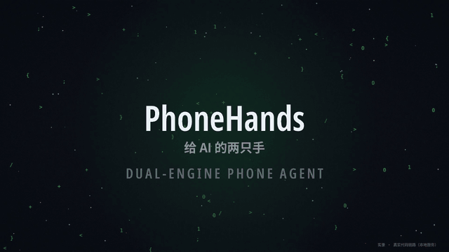
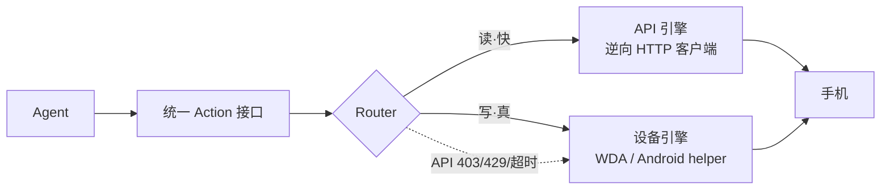

<!-- SPDX-License-Identifier: BUSL-1.1 (pending GC final review) -->

# PhoneHands

[中文](./README.md) | [English](./README.en.md)

-blue)


**API 死了，任务照样跑完。** 另一只手接上——20 条 matches，一条不少。

> Hinge 更新了 App，接口 403 了——20 条 matches 照样读出来了。
> 同一个脚本，Router 自动从 API 引擎切到设备引擎（真机点屏）。



*给 AI 的两只手——一只讲 API（快），一只点屏幕（真）。上图为 8 秒剪辑版 GIF；32 秒完整版视频随发布包提供。画面为真实代码链路实录（本地服务），日志行逐字取自真实运行输出。*

## 诚实声明（先读这 4 条，再决定要不要用）

| # | 事项 | 口径 |
|---|------|------|
| 1 | License | **BSL 1.1**（pending GC 最终文本）：源码全公开；非生产用途免费；生产/商用须向我们申请授权（授权申请经 vertciti.com 联系面）；4 年后自动转 Apache 2.0。不是 OSI 定义的 open source，我们不玩文字游戏。 |
| 2 | ToS 灰色地带 | 只操作**你自己的账号**；默认只读模式（写操作是编译期开关，默认构建里根本不存在）；全程审计日志＋一键断连；框架永不经手你的密码和验证码（暂停→你本人手机上完成→继续）。 |
| 3 | 真无线 | **iOS 跨网真无线是苹果的墙，我们不承诺**。iOS 当前路径：Mac＋备用 iPhone 固定拓扑，一条命令变成远程端点。Android 无线优先：手机主动向外连自托管 agent（同网/跨网均可，无须 USB/同局域网），实现中。 |
| 4 | 埋点 | **零埋点**。自托管运行，不回传任何数据（详见 [ANALYTICS.md](./ANALYTICS.md)）。 |

**当前状态：Phase 1 —— mock 验证通过，未发布。** 仓库保持 private，public 发布需 GC＋CEO 双终审。

## 用一段提示词让 AI 替你装

把下面整段粘贴给你的 AI 助手：

```text
你是我的 PhoneHands 部署助手。先完整读完本仓库 README.md，
然后按顺序执行：
1) bash scripts/phonehands-doctor.sh —— 环境只读体检；
2) npm install —— 安装依赖；
3) npm run build —— 编译全部 workspace；
4) npm test —— 测试全绿才算；
5) 有 Mac + iPhone 才做：bash scripts/remote-topology/test-mock.sh —— 拓扑链路 mock 验证。
全部 PASS 后回复 READY，并列出本轮所有 WARN 项。
遇到问题先查 docs/troubleshooting.md。
安全红线：Apple ID / 密码 / token 只走我亲手操作或环境变量，
绝不写进文件、绝不写进日志。
```

## 30 秒看到它动

```bash
git clone <repo-url> && cd phonehands   # repo-url 待 D-Day 公布
npm install && npm run build && npm test
cd examples/dual-demo && npm test       # mock 演示"API 死了，任务没死"：无需手机
```

真机版本（需要 Mac＋已签名 WDA＋USB 连接的 iPhone，或 Android＋helper APK）：见 [docs/getting-started.md](./docs/getting-started.md)。

## 它能做什么

别管架构——你只关心三件事：**接口挂了你的任务照跑**（真实演示：403 之后设备端接上，20 条 matches 一条不少）；**读数毫秒级**（演示里 406 / 273 / 333 ms）；**写操作默认不存在**（编译期开关，默认构建里根本没有，想误操作都没门）。

| 动作 | 示例 | 哪只手 | 证据 |
|------|------|--------|------|
| `read` / `likes_received` / `matches` / `chat_messages` | 毫秒级拉取 Hinge 点赞/匹配/聊天（结构化 JSON） | API 引擎（只读，编译期锁定） | `adapters/hinge` mock 测试全绿 |
| `observe` | 读 accessibility 树；树不可用时截图回退 | 设备引擎 | `packages/device-backend` mock WDA 测试 |
| `tap` / `swipe` / `type` / `press_home` / `screenshot` / `launch_app` | 真机真实点击、滑动、输入 | 设备引擎 | 同上；loopback-only 断言 |
| 自动降级 | API 403/429/超时 → 设备层接管，`degraded:true` 如实标记 | Router | `@phonehands/core` 故障注入测试 |
| 一键远程拓扑 | Mac 侧一条命令 → 手机变成远程可操作端点（自托管，无第三方云） | 脚本 | `scripts/remote-topology/test-mock.sh` 10/10 PASS |
| 环境体检 | doctor.sh 只读诊断：node/npm/WDA 签名/隧道，FAIL 给修复命令 | 脚本 | 只读，改不了系统 |

**现在还做不了**（写清楚，不画饼）：写操作 API（Phase 2）；微信类自绘 UI 精准定位；7 天签名免续期；GitHub public / npm 发布。

## 双引擎是怎么工作的



**一句话讲自动降级**：接口挂了，你的任务照跑——Router 自己切到"真机点屏"那只手，全程你无感；每一次结果都带 `degraded` 标记，降级了你一定看得见，不确定绝不重放（MV427）。

## 安装

### 前置条件

| 条件 | 要求 |
|------|------|
| 本地开发（无手机） | node 22+、npm、git；`bash scripts/phonehands-doctor.sh` 一键体检 |
| iOS 真机 | Mac＋Xcode＋USB iPhone（WDA 需用你自己的 Apple ID 签名，手机亲手解锁） |
| Android 真机 | helper APK 侧载（源码在 `packages/android-helper`，实现中）＋ agent 端可达的 relay URL |

### 安装（三步以内）

1. `git clone <repo-url> && cd phonehands`（repo-url 待 D-Day 公布）
2. `npm install`
3. `npm run build && npm test`

### 一键远程拓扑（第三条腿）

Mac 路：`bash scripts/remote-topology/setup.sh`（体检→装依赖→WDA 源码→签名→USB 转发→起隧道→输出端点）。
Android 路：helper APK（实现中）＋ relay URL 约定 `PHONEHANDS_RELAY_URL`。
部署手册（写给非技术人员）：`scripts/remote-topology/DEPLOY.md`。无 Mac 可先跑 mock 验证：`bash scripts/remote-topology/test-mock.sh`。

## 快速开始（复制即用）

**例 1：读**（mock，无手机可跑）

```ts
// adapters/hinge/tests/hinge-adapter.test.ts —— 先看测试，再写代码
const hinge = new HingeApiAdapter({ baseUrl: mock.url, locale: { language: "en-US", region: "US" } });
const likes = await hinge.likes_received({ limit: 20 }); // { ok, backend: "api", latency_ms, degraded, evidence }
```

**例 2：看＋点**（需要设备引擎链路）

```ts
// packages/device-backend: tree-first observe，树不可用自动截图回退
const tree = await wda.observe();           // ok:true, degraded:false → 树可用
const pt = screenshotToTapPoint(shot, box, geom); // 调用方给归一化框 → WDA 坐标
await wda.tap(pt.x, pt.y);                  // 单次尝试；超时/断连不重放
```

**例 3：降级演示**（mock，无手机可跑）

```bash
cd examples/dual-demo && npm test
# 场景：读 20 条 matches → 注入 API 403 → 设备引擎接管，envelope 里 degraded:true
```

## 技术亮点

1. **双引擎＋自动降级**：读走 API（毫秒级），写走设备（像真人）；API 死了任务不死，降级如实标记。
2. **只读是编译期开关**：只读构建里写方法根本不存在，不是运行时 flag——想开写得自己重新编译，这是故意的。
3. **不确定绝不重放**：超时/断连的写操作返回 `evidence.uncertain=true`，由 Router 决定下一步，绝不盲重试。
4. **loopback-only 默认**：设备链路拒绝非回环地址，测试断言覆盖；屏幕流只走你自己的通道。
5. **secret 永不落地**：session 文件 0600/原子写/zod 校验＋严格权限门；OTP 只走无回显 TTY；日志全链路脱敏。
6. **自托管到底**：远程拓扑默认 headscale 自托管（BSD-3），healthcheck 自带"中继路径验证"——第三方云中继域名直接判 FAIL。
7. **文档即契约**：README 里每个"支持 X"都有测试证据；证据在包还没交付的，见文末"待补证据链"。

## 工具/动作概览

| 动作 | API 引擎 | iOS 设备引擎 | Android 设备引擎 |
|------|----------|--------------|------------------|
| `read` / `likes_received` / `matches` / `chat_messages` | 支持（只读） | — | — |
| `observe` | — | 支持（树优先＋截图回退） | 支持（协议已冻结） |
| `tap` / `swipe` / `type` / `press_home` / `screenshot` / `launch_app` | — | 支持 | 支持（协议已冻结） |

动作定义见 `@phonehands/core`；能力表见各包 `capabilities.ts`。

## 排障（Top 10）

| 症状 | 原因 | 一条命令 |
|------|------|----------|
| `npm test` 挂 | 依赖/编译没走完 | `npm install && npm run build && npm test`（按包逐个看输出） |
| doctor 报 WDA 签名过期 | 免费 Apple ID 签名 7 天有效期 | `bash scripts/remote-topology/resign.sh`（手机亲手解锁） |
| hinge 412 报错 | 邮箱验证挑战 | 走 `submitEmailChallenge()`，按提示在邮箱完成验证 |
| session 加载被拒绝 | 文件权限被改宽松了 | 删 `~/.phonehands/hinge.session.json` 重新 `loginInteractive()` |
| OTP 提示拒绝运行 | 非 TTY 环境回显风险 | 在真实终端跑，不走管道/CI |
| 429 频繁 | 被限流 | 自带退避＋Retry-After，串行队列已限速（默认 800ms 间隔）；别并发 |
| Android 连不上 agent | relay URL 没配或打不通 | 检查 `PHONEHANDS_RELAY_URL`，格式见 `packages/android-helper/PROTOCOL.md` |
| 真机 USB 不识别 | 未信任电脑 / usbmuxd 没起 | 手机点"信任"，Mac 跑 `brew services start usbmuxd` |
| 想写但调不到写方法 | Phase 1 API 引擎编译期只读 | 这是设计，不是 bug；写走设备引擎（Phase 2 扩展） |
| 降级后不知道哪只手动的 | 没看 envelope | 每个结果都带 `backend`＋`degraded` 字段，以它为准 |

更多见 [docs/troubleshooting.md](./docs/troubleshooting.md)（Top 30）。

## FAQ（先看这里，再去提 issue）

**1. 这跟 iPhone Use 有什么区别？**
iPhone Use 是纯设备层（USB 直连 WDA）。PhoneHands 是双引擎：API 引擎（快）＋设备引擎（真），Router 自动降级；外加第三条腿——一键远程拓扑（Mac 一条命令变成远程可操作端点，自托管）。我们洁净室学习过 iPhone Use，致谢见文末。

**2. API 引擎挂了，我的任务会停吗？**
不会。演示里 1 次 4xx 就切（`degradeAfterFaults` 可配，生产建议 3 次防抖动），真实日志里设备端 read 完成接管——你无感，任务照跑。每一次结果都带 `degraded` 标记，降级了你一定看得见，不会悄悄发生。

**3. 微信/小红书这种自绘 UI 能点准吗？**
这是已知局限，不画饼：accessibility 树不可用时走截图回退链（`observe` 自动降级），但自绘 UI 的精准定位仍在 Phase 2 攻坚。诚实声明第 4 条有完整清单。

**4. BSL 1.1 到底能不能商用？**
源码全公开；非生产用途免费；生产/商用须向我们申请授权（授权申请经 vertciti.com 联系面）；4 年后自动转 Apache 2.0。它不是 OSI 定义的 open source，我们不玩文字游戏。

**5. 我的账号数据会经过你们的服务器吗？**
不会。**零埋点**，自托管运行，不回传任何数据。远程拓扑默认 headscale 自托管；第三方云中继域名会被 healthcheck 直接判 FAIL。

**6. 需要越狱 / root 吗？**
不需要。iOS 走 WDA（用你自己的 Apple ID 签名，手机亲手解锁）；Android 走 helper APK（要无障碍/录屏权限，权限清单见 `packages/android-helper/PROTOCOL.md`）。

**7. 生产环境能用吗？**
Phase 1 是 mock 验证通过，还没发布。建议：先本地试玩（`examples/dual-demo` 无需手机）；生产等门 4b（真机复测）之后。进度见文末"待补证据链"。

**8. 怎么给我的 agent 用？**
三种：① 把本 README "用一段提示词让 AI 替你装"那节整段粘贴给 AI 助手；② MCP server（Phase 2）；③ 直接调 `@phonehands/core` 的统一 Action 接口（`read`/`observe`/`tap`…）。

**9. 跑不起来怎么办？**
先跑 `bash scripts/phonehands-doctor.sh`——只读体检，当场告诉你缺什么、给修复命令；再查 `docs/troubleshooting.md`（Top 10 排障）。还不行，公开后提 issue，贴上 doctor 的输出，我们按看到的顺序回。

## 更新记录

见 [CHANGELOG.md](./CHANGELOG.md)（三段式：改了什么＋验证＋升级指引）。当前最新：v0.1.0（未发布）。

## 依赖与致谢

逐个上游见 [THIRD_PARTY_NOTICES.md](./THIRD_PARTY_NOTICES.md)。核心致谢：

- **appium/WebDriverAgent**（BSD-3）—— iPhone 上的 UI 自动化服务
- **juanfont/headscale**（BSD-3）—— 自托管 WireGuard 组网大脑
- **emazaheri/ios-agent**（MIT 公开口径，待 GC 裁决）—— 设备引擎架构与 WDA 客户端思路来源
- **agentskills** 标准（Apache-2.0）—— skill frontmatter 规范
- 洁净室学习：SideTap（ucsandman）签名运维思路、iPhone Use 深研、vanxh/instagram-personal-mcp（T2 安全模式）

## 引用

```bibtex
@misc{phonehands,
  title = {PhoneHands: two hands for your agent},
  author = {PhoneHands Contributors},
  howpublished = {\url{https://github.com/HUIIIM/phonehands}},
  year = {2026}
}
```

## License

**BSL 1.1 方向（pending GC 最终法律文本）**。源码全公开；非生产用途免费；生产/商用须向我们申请授权（授权申请经 vertciti.com 联系面）；4 年后自动转 Apache 2.0。
每个源文件头：`SPDX-License-Identifier: BUSL-1.1 (pending GC final review)`。永不 MIT。
上游第三方声明：[THIRD_PARTY_NOTICES.md](./THIRD_PARTY_NOTICES.md)。

## 待补证据链（文档即契约门禁）

| claim | 状态 | 证据 ETA |
|-------|------|----------|
| Android helper APK 真机跑通 | 实现中（Kotlin 源码＋协议已冻结） | 一键远程拓扑＋备用机就绪后（门 4b） |
| iOS 一键远程拓扑真机链路 | 脚本已写＋mock 10/10 PASS | 同上（门 4b） |
| 真机降级演示（双屏录像） | demo 脚本为 mock 版 | 同上（门 4b） |
| npm 包公开发布 | 包全部 `private: true`，未发布 | GC＋CEO 双终审后 |
| iOS Simulator 真实 WDA 协议链（门 4a） | ✅ CI 已接入（`.github/workflows/ios-simulator.yml`：手动＋每周）：真实 WDA 构建＋启动于 iPhone Simulator，`simulator-live.test.ts` 零 mock 跑完会话建立/真实 auto-heal/控件树解析/截图/tap/swipe | 已落地 |
| Android Emulator 协议链＋adb 真机烟雾（门 4a） | ✅ CI 已接入（`.github/workflows/android-emulator.yml`：手动＋每周）：e2e 断言＋真实 Android OS 上的 adb tap/screencap | 已落地 |
| CI 徽章点亮 | workflow 已就绪 | public 发布后点亮 |

### 质量门禁 4：两档验证（4a / 4b）——先读这段，再引用我们的测试结论

| 档 | 跑什么 | 证明了什么 | 证明不了什么 |
|---|---|---|---|
| **4a（已落地，$0）** | GitHub Actions：macOS runner 上真实 WDA 跑在 iPhone Simulator；Android Emulator 上真实 adb 命令 | 我们客户端说的**整套协议**（会话/设置/控件树/截图/点按/滑动/自动恢复）对**真实的 WDA 和真实的 Android OS** 是通的 | 物理真机的触控采样、系统弹窗、来电/网络切换打断、免费签名 7 天过期、helper APK 的无障碍/录屏常驻 |
| **4b（待硬件）** | Mac Mini＋备用 iPhone＋备用 Android 物理机 | 上面 4a 证明不了的全部 | — |

**口径红线**：对外一律说"Simulator/Emulator 协议链验证通过"，**绝不**说"真机测试通过"。把 4a 说成真机测试＝虚假陈述，发现一次打回一次。

## Star History

[](https://star-history.com/#HUIIIM/phonehands&date)
