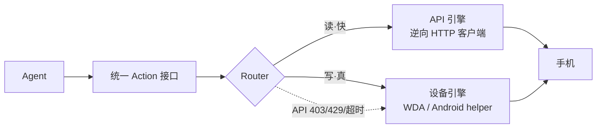

<!-- SPDX-License-Identifier: BUSL-1.1 -->

# PhoneHands

面向 AI agent 开发者的手机操作框架：同一套 Action 接口下有两个引擎，读取走 API（快），点屏走真机设备（真）；API 失效时由 Router 自动切到设备引擎，并在结果里如实标记。

| | |
|---|---|
| 状态 | Phase 1 · v0.1.0，未发布：mock 验证通过；iOS Simulator / Android Emulator 协议链在 GitHub Actions 中验证（手动＋每周）；物理真机复测（门 4b）待硬件 |
| 部署 | 自托管：Node 22+ monorepo（npm workspaces）；iOS 真机需 Mac＋Xcode＋USB iPhone；Android helper APK 实现中 |
| 在线演示 | 不适用：本地库与脚本，没有托管服务；本地 mock 演示见 [`examples/dual-demo`](./examples/dual-demo) |
| 接口 | TypeScript 库（`@phonehands/core` 统一 Action 接口）· 命令行脚本（环境体检、远程拓扑） |
| 许可证 | BUSL-1.1（[LICENSE](LICENSE)），许可方 VERTCITY LLC |
| 语言 | 简体中文 · [English](./README.en.md) |
| 联系 | 安全：暂无 SECURITY.md · 产品：[vertciti.com](https://vertciti.com) |

演示录屏（8 秒 GIF，真实代码链路、本地服务录制）和产品图在 [docs/assets](./docs/assets)；这里只给链接、不内嵌图片。

## 概览

agent 操作手机有两条路：调 App 的 HTTP 接口，速度快但会因 App 更新而失效；在真机上点屏，慢一些但更接近真人操作。PhoneHands 把两条路放在一个统一 Action 接口后面：读取默认走 API 引擎；API 返回 403/429/超时时，Router 切到设备引擎接管同一个任务，每个结果都带 `backend` 和 `degraded` 字段，降级不会悄悄发生。

录屏里的场景：Hinge 接口返回 403 后，设备引擎接上，20 条 matches 全部读出。

第一天能做的：在没有手机的情况下跑通构建、测试和 mock 降级演示；有 Mac＋iPhone 时，用一条命令把手机变成自托管的远程端点。

## 能力一览

| 动作 | 说明 | 引擎 | 证据 |
|------|------|------|------|
| `read` / `likes_received` / `matches` / `chat_messages` | Hinge 点赞、匹配、聊天的结构化 JSON 读取 | API 引擎（只读，编译期锁定） | `adapters/hinge` mock 测试 |
| `observe` | 读 accessibility 树；树不可用时截图回退 | 设备引擎 | `packages/device-backend` mock WDA 测试 |
| `tap` / `swipe` / `type` / `press_home` / `screenshot` / `launch_app` | 真机点击、滑动、输入 | 设备引擎 | 同上；loopback-only 断言 |
| 自动降级 | API 403/429/超时 → 设备层接管，`degraded:true` 标记 | Router | `@phonehands/core` 故障注入测试 |
| 一键远程拓扑 | Mac 侧一条命令 → 手机变成远程可操作端点（自托管，无第三方云） | 脚本 | `scripts/remote-topology/test-mock.sh` |
| 环境体检 | `phonehands-doctor.sh` 只读诊断 node/npm/WDA 签名/隧道，FAIL 项给修复命令 | 脚本 | 只读，不改系统 |

按引擎划分：

| 动作 | API 引擎 | iOS 设备引擎 | Android 设备引擎 |
|------|----------|--------------|------------------|
| `read` / `likes_received` / `matches` / `chat_messages` | 支持（只读） | — | — |
| `observe` | — | 支持（树优先＋截图回退） | 协议已冻结，真机验证待门 4b |
| `tap` / `swipe` / `type` / `press_home` / `screenshot` / `launch_app` | — | 支持 | 协议已冻结，真机验证待门 4b |

动作定义见 `@phonehands/core`；能力表见各包 `capabilities.ts`。

## 快速开始

```bash
git clone <repo-url> && cd phonehands   # repo-url 待公开发布时公布
npm install && npm run build && npm test
cd examples/dual-demo && npm test       # mock 降级演示，无需手机
```

### 前置条件

| 条件 | 要求 |
|------|------|
| 本地开发（无手机） | node 22+、npm、git；`bash scripts/phonehands-doctor.sh` 一键体检 |
| iOS 真机 | Mac＋Xcode＋USB iPhone（WDA 用你自己的 Apple ID 签名，手机亲手解锁） |
| Android 真机 | helper APK 侧载（源码在 `packages/android-helper`，实现中）＋ agent 端可达的 relay URL |

真机步骤见 [docs/getting-started.md](./docs/getting-started.md)。

### 一键远程拓扑

Mac：`bash scripts/remote-topology/setup.sh`（体检 → 装依赖 → WDA 源码 → 签名 → USB 转发 → 起隧道 → 输出端点）。
Android：helper APK（实现中）＋ `PHONEHANDS_RELAY_URL`。
部署手册（写给非技术人员）：`scripts/remote-topology/DEPLOY.md`。没有 Mac 可先跑 mock：`bash scripts/remote-topology/test-mock.sh`。

### 代码示例

**读**（mock，无手机可跑）

```ts
// adapters/hinge/tests/hinge-adapter.test.ts
const hinge = new HingeApiAdapter({ baseUrl: mock.url, locale: { language: "en-US", region: "US" } });
const likes = await hinge.likes_received({ limit: 20 }); // { ok, backend: "api", latency_ms, degraded, evidence }
```

**看＋点**（需要设备引擎链路）

```ts
// packages/device-backend：树优先 observe，树不可用自动截图回退
const tree = await wda.observe();                 // ok:true, degraded:false → 树可用
const pt = screenshotToTapPoint(shot, box, geom); // 调用方给归一化框 → WDA 坐标
await wda.tap(pt.x, pt.y);                        // 单次尝试；超时/断连不重放
```

**降级演示**（mock，无手机可跑）

```bash
cd examples/dual-demo && npm test
# 场景：读 20 条 matches → 注入 API 403 → 设备引擎接管，envelope 里 degraded:true
```

### 让 AI 助手代为安装

把下面整段粘贴给你的 AI 助手：

```text
你是我的 PhoneHands 部署助手。先完整读完本仓库 README.md，
然后按顺序执行：
1) bash scripts/phonehands-doctor.sh —— 环境只读体检；
2) npm install —— 安装依赖；
3) npm run build —— 编译全部 workspace；
4) npm test —— 测试全绿才算；
5) 有 Mac + iPhone 才做：bash scripts/remote-topology/test-mock.sh —— 拓扑链路 mock 验证。
全部 PASS 后回复 READY，并列出本轮所有 WARN 项。
遇到问题先查 docs/troubleshooting.md。
安全红线：Apple ID / 密码 / token 只走我亲手操作或环境变量，
绝不写进文件、绝不写进日志。
```

## 架构



- **双引擎＋自动降级**：读走 API，写走设备；降级在每个结果的 `degraded` 字段里标明。`degradeAfterFaults` 可配：演示里 1 次 4xx 就切，生产建议 3 次防抖动。
- **只读是编译期开关**：只读构建里写方法不存在，不是运行时 flag；要开放写操作需自行重新编译。
- **不确定不重放**：超时/断连的写操作返回 `evidence.uncertain=true`，由 Router 决定下一步，不盲目重试（the no-auto-replay rule）。
- **loopback-only 默认**：设备链路拒绝非回环地址，有测试断言覆盖。

详见 [docs/architecture.md](./docs/architecture.md)。

## 安全与合规

- **只操作你自己的账号。** API 引擎使用逆向 HTTP 客户端，属于平台服务条款的灰色地带；默认只读，写操作默认构建里不存在。
- **审计与断连。** 全程审计日志，一键断连。
- **凭据不经手、不落地。** 框架不经手密码和验证码（暂停 → 你在自己手机上完成 → 继续）；session 文件 0600、原子写、zod 校验＋严格权限门；OTP 只走无回显 TTY；日志全链路脱敏。
- **零埋点。** 自托管运行，不回传任何数据（[ANALYTICS.md](./ANALYTICS.md)）。远程拓扑默认用自托管 headscale；healthcheck 的中继路径验证会把第三方云中继域名判为 FAIL。
- **无需越狱 / root。** iOS 走 WDA（自己的 Apple ID 签名）；Android 走 helper APK（需无障碍/录屏权限，清单见 `packages/android-helper/PROTOCOL.md`）。

仓库暂无 SECURITY.md 漏洞报告流程。

## 现状与边界

v0.1.0，未发布。仓库已公开（已通过合规放行）；npm 包全部 `private: true`，未发布。仓库目前没有在 PR 上运行的 CI；已接入的 workflow 是 iOS Simulator 与 Android Emulator 协议链（手动＋每周）。

**目前做不到**：API 写操作（Phase 2）；微信类自绘 UI 的精准定位；免费 Apple ID 签名 7 天有效期需续签；iOS 跨网真无线（受苹果平台限制，不承诺；当前路径是 Mac＋备用 iPhone 固定拓扑）；MCP 服务（目前没有）。

### 待补证据链

| 声明 | 状态 | 证据时间点 |
|-------|------|----------|
| Android helper APK 真机跑通 | 实现中（Kotlin 源码＋协议已冻结） | 远程拓扑＋备用机就绪后（门 4b） |
| iOS 一键远程拓扑真机链路 | 脚本已写，mock 通过 | 同上（门 4b） |
| 真机降级演示（双屏录像） | demo 脚本为 mock 版 | 同上（门 4b） |
| npm 包公开发布 | 未发布 | GC＋CEO 双终审后 |
| iOS Simulator 真实 WDA 协议链（门 4a） | 已接入 CI（`.github/workflows/ios-simulator.yml`，手动＋每周）：真实 WDA 构建并启动于 iPhone Simulator，`simulator-live.test.ts` 零 mock 跑会话建立 / auto-heal / 控件树解析 / 截图 / tap / swipe | 已落地 |
| Android Emulator 协议链＋adb 烟雾（门 4a） | 已接入 CI（`.github/workflows/android-emulator.yml`，手动＋每周）：e2e 断言＋真实 Android OS 上的 adb tap/screencap | 已落地 |

### 质量门禁 4：两档验证（4a / 4b）

| 档 | 跑什么 | 证明了什么 | 证明不了什么 |
|---|---|---|---|
| **4a（已落地）** | GitHub Actions：macOS runner 上真实 WDA 跑在 iPhone Simulator；Android Emulator 上真实 adb 命令 | 客户端说的整套协议（会话/设置/控件树/截图/点按/滑动/自动恢复）对真实 WDA 和真实 Android OS 是通的 | 物理真机的触控采样、系统弹窗、来电/网络切换打断、免费签名 7 天过期、helper APK 的无障碍/录屏常驻 |
| **4b（待硬件）** | Mac Mini＋备用 iPhone＋备用 Android 物理机 | 4a 证明不了的全部 | — |

**口径**：对外一律说"Simulator/Emulator 协议链验证通过"，不说"真机测试通过"。

## 排障（Top 10）

| 症状 | 原因 | 处理 |
|------|------|----------|
| `npm test` 挂 | 依赖/编译没走完 | `npm install && npm run build && npm test`（按包逐个看输出） |
| doctor 报 WDA 签名过期 | 免费 Apple ID 签名 7 天有效期 | `bash scripts/remote-topology/resign.sh`（手机亲手解锁） |
| hinge 412 报错 | 邮箱验证挑战 | 走 `submitEmailChallenge()`，按提示在邮箱完成验证 |
| session 加载被拒绝 | 文件权限被改宽松了 | 删 `~/.phonehands/hinge.session.json` 重新 `loginInteractive()` |
| OTP 提示拒绝运行 | 非 TTY 环境回显风险 | 在真实终端跑，不走管道/CI |
| 429 频繁 | 被限流 | 自带退避＋Retry-After，串行队列已限速（默认 800ms 间隔）；不要并发 |
| Android 连不上 agent | relay URL 没配或打不通 | 检查 `PHONEHANDS_RELAY_URL`，格式见 `packages/android-helper/PROTOCOL.md` |
| 真机 USB 不识别 | 未信任电脑 / usbmuxd 没起 | 手机点"信任"，Mac 跑 `brew services start usbmuxd` |
| 调不到写方法 | Phase 1 API 引擎编译期只读 | 这是设计；写走设备引擎（Phase 2 扩展） |
| 不知道哪个引擎执行的 | 没看 envelope | 每个结果都带 `backend`＋`degraded` 字段，以它为准 |

更多见 [docs/troubleshooting.md](./docs/troubleshooting.md)。

## 常见问题

**和 iPhone Use 有什么区别？**
iPhone Use 是纯设备层（USB 直连 WDA）。PhoneHands 是双引擎（API＋设备）加 Router 自动降级，另有一键远程拓扑。我们以洁净室方式学习过 iPhone Use，致谢见下。

**我的账号数据会经过你们的服务器吗？**
不会。自托管运行，零埋点，不回传数据。

**生产环境能用吗？**
还不能。Phase 1 只是 mock 验证通过，尚未发布；生产使用应等门 4b（物理真机复测）之后。可以先在本地跑 `examples/dual-demo`（无需手机）。

**怎么接入我的 agent？**
直接调用 `@phonehands/core` 的统一 Action 接口（`read` / `observe` / `tap` …），或把上面"让 AI 助手代为安装"那段交给 AI 助手。目前没有 MCP 服务。

**跑不起来怎么办？**
先跑 `bash scripts/phonehands-doctor.sh`（只读体检，给出缺什么和修复命令），再查 [docs/troubleshooting.md](./docs/troubleshooting.md)。

## 文档 · 支持 · 许可证

[快速上手](./docs/getting-started.md) · [架构](./docs/architecture.md) · [排障](./docs/troubleshooting.md) ·
[质量门禁](./docs/quality-gates.md) · [发布 SOP](./docs/release-sop.md) · [更新记录](./CHANGELOG.md)（当前：v0.1.0，未发布）·
[埋点声明](./ANALYTICS.md)

**依赖与致谢**（逐个上游见 [THIRD_PARTY_NOTICES.md](./THIRD_PARTY_NOTICES.md)）：

- **appium/WebDriverAgent**（BSD-3）：iPhone 上的 UI 自动化服务
- **juanfont/headscale**（BSD-3）：自托管 WireGuard 组网
- **emazaheri/ios-agent**（公开页面标注 MIT，待 GC 裁决）：设备引擎架构与 WDA 客户端思路来源
- **agentskills** 标准（Apache-2.0）：skill frontmatter 规范
- 洁净室学习：SideTap（ucsandman）签名运维思路、iPhone Use、vanxh/instagram-personal-mcp（T2 安全模式）

**引用**

```bibtex
@misc{phonehands,
  title = {PhoneHands: two hands for your agent},
  author = {PhoneHands Contributors},
  howpublished = {\url{https://github.com/HUIIIM/phonehands}},
  year = {2026}
}
```

**许可证：BUSL-1.1。** 源码公开；非生产用途免费；生产/商用须向许可方 VERTCITY LLC 申请商业授权；各版本自首次公开发行满 4 年转 Apache 2.0。BUSL 不是 OSI 定义的开源许可证。全文见 [LICENSE](LICENSE)。

---

由 [vertciti](https://vertciti.com) 构建。
