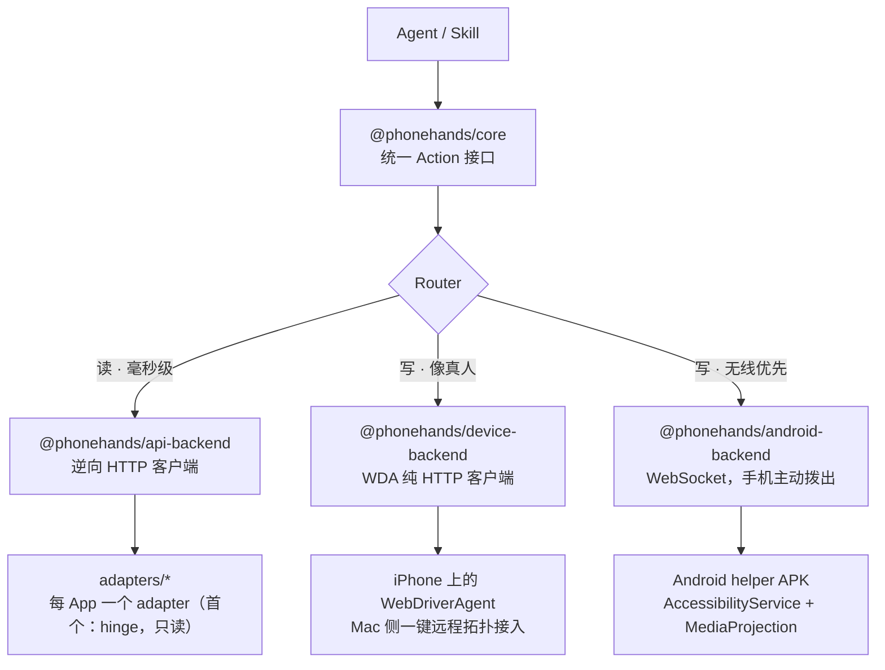

<!-- SPDX-License-Identifier: BUSL-1.1 (pending GC final review) -->

# PhoneHands 架构

## 双引擎总览



## Router 决策（一句话）

读走 API（快），写走设备（真）。API 连续失败（403/429/超时三件套，故障注入测试覆盖）→ 标 `degraded` → 设备引擎接管。

## 结果 envelope（统一契约）

```ts
{ ok: boolean, backend: "api" | "device", latency_ms: number, degraded: boolean, evidence: object }
```

- `backend`：这一下是哪只手动的——永远以它为准，不猜。
- `degraded:true`：降级发生，调用方必须知道。
- `evidence.uncertain=true`：写操作超时/断连，不确定执行了没——**绝不重放**（MV427），Router 或人决定下一步。

## 动作表（core 定义）

`observe / tap / tap_text / swipe / type_text / read / launch_app / press_home / screenshot`

每个引擎用 `capabilities.ts` 向 Router 声明自己会什么、不会什么。API 引擎在 Phase 1 是**编译期只读**：写方法在代码层面不存在，不是运行时开关。

## 设备引擎降级链（iOS，caller flow）

1. `observe()` 树优先：可用返回 `ok:true, degraded:false`。
2. 树不可用 → 截图，`ok:true, degraded:true, evidence.tree_unavailable=true`。单次尝试，不盲重试。
3. 调用方（Router/模型视觉/人）给**归一化框**（0..1）。
4. `screenshotToTapPoint(shot, box, { logicalWidth, logicalHeight, screenshotOrientation })` → WDA 坐标；方向不一致 loud fail。
5. `tap(x, y)` 单次；超时/断连 → `ok:false, evidence.uncertain=true`，不重放。

## Android 无线链路

手机主动向外拨 WebSocket（`PHONEHANDS_RELAY_URL` 约定），无须 USB、无须同局域网、无须 root。
协议见 `packages/android-helper/PROTOCOL.md`（已冻结）；真机验证排队中（门 4 PENDING）。

## 安全模型（摘要）

- 只读编译期开关；写默认拒绝 allowlist（Phase 2 预留）。
- 认证交接：pause → 人在手机上完成 → resume；框架永不碰密码/OTP。
- loopback-only 设备链路；审计日志全链路脱敏；一键断连。
- 完整版 Phase 3 出 `docs/security.md`。

## Adapter 开发指南（给贡献者）

1. 在 `adapters/<app>/` 建包，scope `@phonehands/<app>-adapter`。
2. 读操作走 `@phonehands/api-backend` 的模块（fingerprint/http-client/login-state-machine/session-store/redact）；写操作 Phase 1 不做。
3. 构造函数**必须**要求显式 `baseUrl`，不许有生产默认（测试红线：mock server 只跑 127.0.0.1）。
4. 每个结果包 core envelope；`capabilities.ts` 声明能力表。
5. 测试：mock server＋故障注入（403/429/412）；secret 进日志路径喂假值断言零残留。
6. `THIRD_PARTY_NOTICES.md` 登记任何新上游；新文件加 BSL header。
7. PR 模板走 `.github/pull_request_template.md`；文档即契约——README 里的每个能力都要有测试对应。
